# TradeFlow

**Multi-horizon trend forecasting for NSE stocks, evaluated without leakage.** A Streamlit dashboard on top of
XGBoost models trained on 180 Indian stocks with technical, trend and market-context features. Every reported number
comes from purged walk-forward validation or a held-out test period that was scored once, after the configuration was
frozen.

[](https://tradeflowai.streamlit.app)


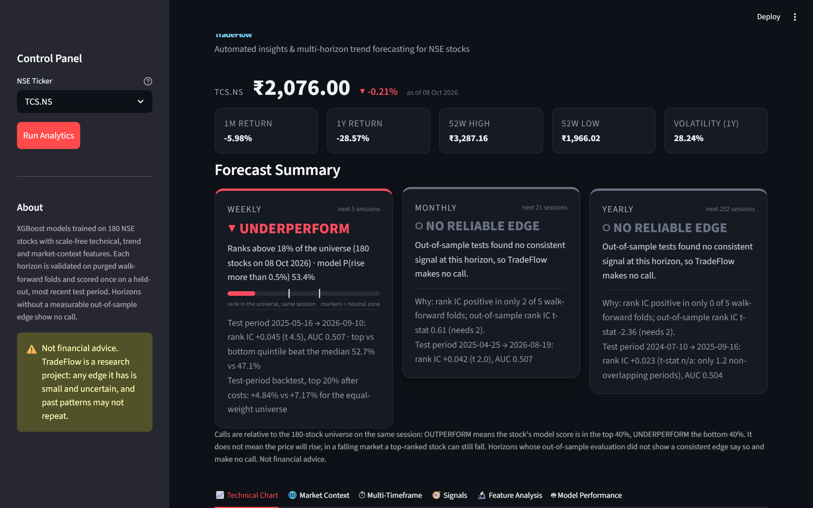

> **Not financial advice.** TradeFlow is a research and learning project. Only the weekly horizon shows a reliable
> out-of-sample edge, and it is small: it ranks stocks slightly better than chance but did not beat an equal-weight
> portfolio after trading costs. The monthly and yearly horizons show no reliable edge and the app makes no call
> for them.

---

## Contents

- [Results](#results)
- [How to read a forecast](#how-to-read-a-forecast)
- [Validation method](#validation-method)
- [What was tried](#what-was-tried)
- [Leakage audit](#leakage-audit)
- [Limitations](#limitations)
- [Quick start](#quick-start)
- [Project layout](#project-layout)
- [Screenshots](#screenshots)
- [Tech stack](#tech-stack)

## Results

### Final test period (held out, scored once)

Each horizon's test period is the most recent 15% of its labelled sessions. Nothing in it was used for any
decision: the configuration was frozen and committed (`8407177`) before it was scored.

| Horizon | Model | AUC (UP > 0.5%) | AUC (beat median) | Rank IC (t-stat) | Top / bottom 20% beat the median | Edge |
| --- | --- | --- | --- | --- | --- | --- |
| **Weekly** (5 sessions) <br> 2025-05-16 → 2026-09-10 | Before, as reported | 0.488 | – | – | – | – |
| | Before, re-scored with the purged split | 0.485 | 0.508 | +0.052 (4.8) | 52.9% / 46.6% | – |
| | **After** | **0.523** | **0.507** | **+0.045 (4.5)** | **52.7% / 47.1%** | **reliable** |
| **Monthly** (21 sessions) <br> 2025-04-25 → 2026-08-19 | Before, as reported | 0.526 | – | – | – | – |
| | Before, re-scored with the purged split | 0.535 | 0.509 | +0.030 (1.7) | 52.3% / 48.6% | – |
| | **After** | **0.494** | **0.507** | **+0.042 (2.0)** | **52.7% / 47.4%** | **none** |
| **Yearly** (252 sessions) <br> 2024-07-10 → 2025-09-16 | Before, as reported | 0.547 | – | – | – | – |
| | Before, re-scored with the purged split | 0.546 | 0.500 | +0.005 (n/a) | 49.5% / 48.6% | – |
| | **After** | **0.521** | **0.504** | **+0.023 (n/a)** | **50.3% / 47.3%** | **none** |

* **Rank IC** is the Spearman correlation between the model score and the realised forward return across stocks on
  each day, averaged over days. 0 is no skill. **AUC (beat median)** scores the same ranking against "beats the
  median stock over the horizon". **AUC (UP > 0.5%)** is the original metric: absolute direction, pooled over all
  days, so it mostly measures market timing.
* t-stats use Newey-West standard errors (lag = horizon) because consecutive days share most of their forward window.
  The yearly test period contains about 1.2 non-overlapping years, so no t-stat is meaningful there.
* "Before" is the previously deployed configuration (LightGBM / HistGradientBoosting). "As reported" is the number the
  old pipeline published; "re-scored" trains that same configuration with the new purged split on the 180-stock
  universe and scores the same test period.

### What the results mean

* **Weekly: a real but thin ranking edge.** Rank IC is positive in all 5 walk-forward folds (+0.034 ± 0.012) and on
  the test period (+0.045, t = 4.5); it barely changes when the trade is entered at the next session's open
  (+0.042), so it is not a closing-price artefact. The old weekly model already had this edge: its 0.488 AUC was
  measuring market timing, which neither model can do. The signal does not survive trading costs, though: a
  long-only top-20% portfolio rebalanced weekly turned over almost completely each week and returned +4.8% against
  +7.2% for the equal-weight universe after 15 bps per side (see [backtest](#backtest)).
* **Monthly: no reliable edge.** The test period looks good (rank IC +0.042, t = 2.0, and a +22.0% backtest against
  +15.5%), but the five walk-forward folds averaged −0.004 with only 2 of 5 positive. One good period after five mixed
  ones is not evidence; under the edge rule fixed before testing, the app makes no monthly call.
* **Yearly: no edge.** Rank IC was negative in all 5 folds (−0.066 ± 0.057): the model learns which kinds of stocks
  rose in its training years, and that ranking reverses. With 252-session labels each training window holds only a
  handful of independent years.
* **None of the five suggested improvements helped consistently** (relative target, clear-move labels, cross-sectional
  ranks, weekly short-term features, more regularisation). Details in [What was tried](#what-was-tried).

### Walk-forward validation (5 purged folds, mean ± std)

| Horizon | Model | Rank IC | Folds with IC > 0 | AUC (beat median) | AUC (UP > 0.5%) | Top / bottom 20% beat median |
| --- | --- | --- | --- | --- | --- | --- |
| Weekly | Before | +0.037 ± 0.012 | 5/5 | 0.506 ± 0.001 | 0.513 ± 0.028 | 52.6% / 47.7% |
| | After | +0.034 ± 0.012 | 5/5 | 0.505 ± 0.002 | 0.509 ± 0.027 | 52.2% / 47.8% |
| Monthly | Before | +0.005 ± 0.036 | 2/5 | 0.499 ± 0.008 | 0.518 ± 0.056 | 50.6% / 50.2% |
| | After | −0.004 ± 0.036 | 2/5 | 0.497 ± 0.007 | 0.490 ± 0.023 | 50.0% / 50.8% |
| Yearly | Before | −0.055 ± 0.026 | 0/5 | 0.476 ± 0.011 | 0.518 ± 0.059 | 43.3% / 50.4% |
| | After | −0.066 ± 0.057 | 0/5 | 0.473 ± 0.018 | 0.525 ± 0.057 | 42.4% / 50.9% |

The "before" fold numbers are flattering: the old weekly feature set was selected using data that covers these folds
(see [Leakage audit](#leakage-audit)).

**AUCs above 0.60 were investigated.** Pooled AUC (UP) reaches 0.60 in one monthly fold (old configuration,
Jul 2022 → Jun 2023) and 0.62–0.69 in the first yearly fold (Jan → Sep 2020, the COVID crash and rebound). Splitting
it into a between-day and a within-day part shows all of it is market timing: the model's average score per day
tracked how many stocks went up (over about 11 independent months, and about 1 independent year), while its ranking of
stocks within each day was below chance in those same folds (rank IC −0.05 and −0.07). It is not leakage (every
feature passes the point-in-time audit), and it is why pooled absolute AUC is a misleading headline metric. On the
weekly horizon no AUC exceeds 0.57.

### Backtest

Long-only, equal weight, top 20% of the universe by model score, rebalanced every horizon, filled at the next
session's open with 10 bps costs + 5 bps slippage per side, from ₹10,00,000, over each horizon's test period.

| Horizon | Rebalances | Model | Equal-weight universe | Previous model | Sharpe | Max drawdown | Costs paid |
| --- | --- | --- | --- | --- | --- | --- | --- |
| Weekly | 66 | +4.8% | +7.2% | +6.8% | 0.32 | −9.0% | 19.8% |
| Monthly | 15 | +22.0% | +15.5% | +13.4% | 0.95 | −12.4% | 4.5% |
| Yearly | 1 | +0.6% | +1.3% | −0.7% | – | – | 0.3% |

The universe is today's stock list, so absolute returns carry survivorship bias; the benchmark shares it, so the
difference is the meaningful part. A single yearly rebalance is an anecdote.

## How to read a forecast

Calls are **relative**: the stock's model score is ranked against all 180 universe stocks on the same session (the app
scores the whole universe and caches it for an hour), because that same-day ranking is what was validated.

| Card | Meaning |
| --- | --- |
| **OUTPERFORM** | The stock's score is in the top 40% of the universe today |
| **NEUTRAL** | Middle 20% |
| **UNDERPERFORM** | Bottom 40% |
| **NO RELIABLE EDGE** | The horizon failed the out-of-sample edge rule; no call is made, and the card says why |
| **RANK UNAVAILABLE** | The same-session universe could not be downloaded; no call rather than a stale comparison |

OUTPERFORM does not mean the price will rise: in a falling market a top-ranked stock can still fall. During market
hours forecasts use the last completed session. "Why the model says this" shows each feature's SHAP contribution
for this stock minus the average stock's on the same session, so market-wide inputs cancel out.

## Validation method

* **Data.** Yahoo Finance daily OHLCV (split- and dividend-adjusted) for 180 NSE stocks, NIFTY 50, India VIX,
  USD/INR and three sector indices. Prices from 2016-09-19; feature rows from 2017-09-25 to **2026-09-17**, where the
  dataset is frozen (`data/cache/dataset_meta.json`) so every run sees identical data.
* **Labels** (`features/labels.py`). For a row on day t and horizon h: forward return `Close[t+h] / Close[t] − 1`
  (h rows of the stock's own history). Absolute label: return > 0.5%. Relative label: return above the same-day
  median of all stocks. Each label records the date of the last price it uses (`label_end`).
* **Purged walk-forward split** (`models/evaluation.py`). The last 15% of labelled sessions is the final test
  period. The development period before it is cut into 5 consecutive validation blocks; each block is evaluated by
  a model trained on an expanding window of earlier rows that are (a) dated at least h sessions before the block and
  (b) have a label window ending before the block starts. Validation labels also end before the test period starts,
  so no development decision touches a test-period price. There is no shuffling anywhere. `tests/test_purged_split.py`
  checks these properties, including the case where a trading halt stretches a label past the gap.
* **Metrics per fold**: ROC AUC (relative and absolute labels), rank IC (daily, averaged; also measured from the next
  session's open), and the hit rate of the top versus bottom quintile, reported as mean ± std across folds.
* **Decision rule for experiments** (fixed before running them): a change is kept only if mean rank IC improves,
  rank IC improves in at least 4 of the 5 folds, and mean relative AUC does not fall.
* **Edge rule** (fixed before the test period was scored): a horizon gets calls only if rank IC is positive on
  average and in at least 4 of 5 folds, positive on the test period, and the Newey-West t-stat of the daily IC over
  every out-of-sample day is at least 2.
* **Final model**: trained once on every purged row before the test period, scored once on it, saved as is. The
  deployed model is exactly the model whose test numbers are shown; it never saw test-period data.
* **Reproducibility**: seed 42, XGBoost `hist` trained on the GPU (`device="cuda"`, RTX 4060) with automatic CPU
  fallback; three GPU runs reproduced identical fold metrics, and a CPU run matches them to within 0.001 AUC.
  Results live in `models/saved_models/metrics.json`, which the app reads (no metric is hard-coded in the UI).

## What was tried

Full table with fold-by-fold numbers: [`reports/experiment_log.md`](reports/experiment_log.md). Each change was
compared with the configuration it would replace; Δ is the change in mean rank IC, with the number of folds (of 5)
that improved.

| Change | Weekly | Monthly | Yearly | Kept? |
| --- | --- | --- | --- | --- |
| XGBoost in place of LightGBM / HistGB, equivalent settings | +0.002 (3) | −0.003 (1) | −0.003 (1) | adopted (decision) |
| Relative target: beat the universe median | −0.005 (1) | +0.003 (3) | −0.000 (1) | no |
| Clear-move labels, k = 0.25 / 0.5 | −0.000 (2) / −0.004 (1) | −0.008 (1) / −0.001 (3) | −0.006 (0) / +0.013 (1) | no |
| Cross-sectional ranks of stock-level features | −0.005 (2) | +0.001 (2) | −0.023 (1) | no |
| Weekly features: 5-day relative strength, volume surprise | +0.001 (1) | – | – | no |
| Shallower trees, larger leaves, subsampling (depth 4 / depth 3) | −0.002 (2) / −0.003 (2) | −0.011 (1) / −0.008 (1) | −0.013 (2)* | no |
| Early stopping on a purged hold-out (pooled AUC / rank IC) | −0.031 (0) / −0.009 (3) | −0.004 (2) / +0.001 (2) | +0.025 (2) / +0.008 (2) | no |
| Prune features without stable importance | −0.033 (0) | −0.022 (1) | +0.032 (3) | no |

\* Yearly is already depth 2, so its regularised variant keeps depth 2 and adds larger leaves and subsampling.

Why several of these hurt: with an absolute target, market-wide features (identical for every stock on a day) carry
most of the split gain, so gain-based pruning keeps them and drops the stock-level features that do the ranking, and
early stopping on pooled AUC stops after a handful of trees that only split on market features. The relative target
removes that problem but, on these folds, ranked stocks no better.

## Leakage audit

The full audit is in [`docs/AUDIT.md`](docs/AUDIT.md). In short:

| Finding | Effect of the fix |
| --- | --- |
| The deployed models were refit on every labelled row, test period included | On their own test periods they scored AUC 0.732 / 0.705 / 0.579 (in-sample). The deployed model is now the evaluated one: 0.523 / 0.494 / 0.521 |
| Committed models still traded the NIFTY 50 index as a stock | Fold rank IC changed by −0.000 / −0.001 / +0.006 |
| Weekly features selected with the validation folds (mutual information, permutation importance) | Starting every horizon from the unselected 69-feature pool lowered fold rank IC by 0.005 / 0.006 / 0.008: part of the old CV score was selection bias |
| Purge counted rows, not label end dates | Now purged on label end dates; no row in this dataset was affected (0 at all 18 boundaries) |
| The app overwrote the training price cache | Fixed; the dataset is frozen at one end date |
| Survivorship: today's stock list | Documented below; not fixable without point-in-time index membership |

Checked and clean: no scaler or indicator is fitted on the full dataset (trees, trailing windows only), the
point-in-time rebuild finds no look-ahead in any of 139 features, USD/INR is lagged a session, intraday bars are
aligned to the 15:30 close, and there is no random split anywhere.

## Limitations

* **Survivorship bias.** The universe is today's large and mid caps, including later IPOs and recent multi-baggers,
  with no delisted names. Absolute returns and "UP" rates are inflated; relative metrics are less exposed but not
  immune.
* **Small effective samples.** Daily rows with 5/21/252-session labels overlap heavily. The yearly horizon has only a
  handful of independent observations, so its results are anecdotal whatever the sign.
* **The test periods are not pristine at the project level.** The previous README reported results on the same
  periods for six feature setups. No decision in this round used them, but the earlier iteration may have.
* **Many configurations were compared on the same folds** (about 13 per horizon). The 4-of-5-folds rule limits but
  does not remove selection bias in the fold numbers; the test numbers are the unbiased ones.
* **Statistical edge ≠ profit.** The weekly ranking edge is too small to pay for near-complete weekly turnover at
  15 bps per side. No capacity, liquidity or shorting is modelled.
* **The deployed models have not seen the most recent data.** They were trained only on data before each test
  period (weekly: until May 2025), so that their reported numbers apply to them. Refitting on all data might help
  slightly but would leave the deployed model without an honest test score.
* **Single data source.** Yahoo Finance revises recent bars and adjustment factors (a few stocks differed by up to
  0.8 standard deviations on recent dates between two downloads), and its intraday history is short.
* **Close-to-close labels.** A forecast made at the close cannot trade at that close; the next-open rank IC shows the
  tradable version (weekly +0.042 vs +0.045).
* **Live ranking cost.** Calls need the whole universe for the same session: 180 downloads plus feature building,
  between 30 seconds and a couple of minutes depending on Yahoo's response times, then cached for an hour.

## Quick start

```bash
git clone https://github.com/piyushp69/TradeFlow.git
cd TradeFlow
python -m venv .venv
# Windows: .venv\Scripts\activate    macOS/Linux: source .venv/bin/activate
pip install -r requirements.txt

streamlit run app.py      # dashboard on http://localhost:8501, using the trained models in models/saved_models/
```

Trained models, `metrics.json` and reports are committed, so the dashboard works straight away. To reproduce the
research (needs `pip install -r requirements-dev.txt` for the LightGBM baseline and pytest):

```bash
python experiments.py     # baseline, leakage-fix measurements and the experiment ladder on walk-forward folds (~15 min on a GPU)
#   -> freeze the chosen configuration in models/config.py (FINAL_SPECS); trainer.py refuses a config that differs
python trainer.py         # frozen dataset -> leakage audit -> folds -> final model -> one test evaluation -> reports (~4 min)
pytest                    # labels, purged splits, metrics, cross-sectional ranks, edge gating in the app
```

| `trainer.py` flag | Effect |
| --- | --- |
| `--rebuild-data` | Rebuild the cached feature dataset from the price cache |
| `--data-end YYYY-MM-DD` | Freeze the dataset at another date (default: last cached NIFTY session) |
| `--no-cache` | Re-download prices |
| `--horizons weekly monthly` | Train a subset of horizons |
| `--cpu` | Train on the CPU even when a GPU is available |
| `--skip-baseline` | Do not re-score the previous models (otherwise needs LightGBM) |

The `xgboost` wheel trains on an NVIDIA GPU when CUDA is available and on the CPU otherwise; the saved models are
switched to CPU inference so they load on Streamlit Community Cloud.

## Project layout

| Path | Purpose |
| --- | --- |
| `app.py`, `ui/` | Streamlit dashboard |
| `trainer.py` | Frozen dataset → leakage audit → walk-forward folds → final model → one test evaluation → reports |
| `experiments.py` | Baseline, leakage-fix measurements and the experiment ladder on walk-forward folds only |
| `data/fetcher.py`, `data/universe.py`, `data/sectors.py` | Downloads and cache, the 180-stock universe, sector membership |
| `features/` | Indicators, market and multi-timeframe features (`pipeline.py`), labels (`labels.py`), cross-sectional ranks, point-in-time leakage audit |
| `models/evaluation.py` | Purged walk-forward split, metrics, Newey-West t-stat, edge rule |
| `models/training.py`, `models/config.py` | Model specs, XGBoost fitting (GPU/CPU), baseline and frozen final configurations |
| `models/predictor.py`, `models/inference.py` | Load bundles and `metrics.json`, same-session universe ranking, SHAP explanations |
| `models/saved_models/` | Model bundles per horizon and `metrics.json` (fold metrics, test metrics, training date, data range) |
| `backtest/engine.py` | Cross-sectional long-only backtest with costs, slippage and a benchmark |
| `reports/` | Experiment log, backtests, equity curves, feature importance, leakage audit, training log |
| `docs/AUDIT.md` | Leakage and evaluation audit |
| `tests/` | Unit tests |

## Screenshots

Screenshots taken from a local run on 8 October 2026 with TCS.NS.

| 🏠 Home | 📈 Technical chart |
| --- | --- |
| 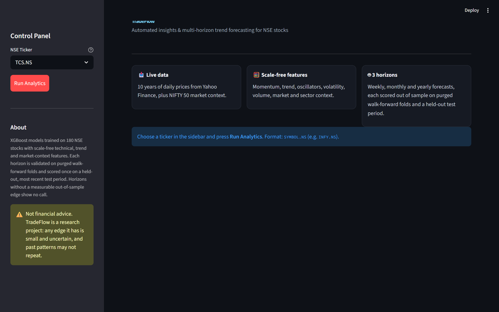 | 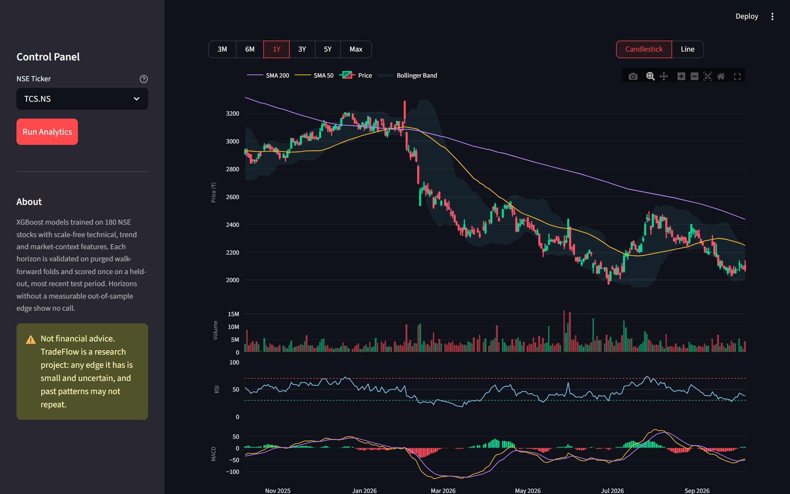 |
| **🌐 Market context** | **⏱ Multi-timeframe** |
| 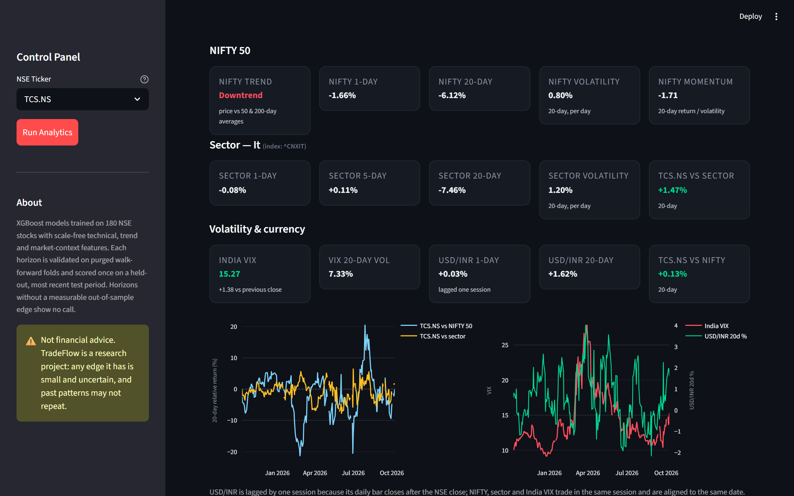 | 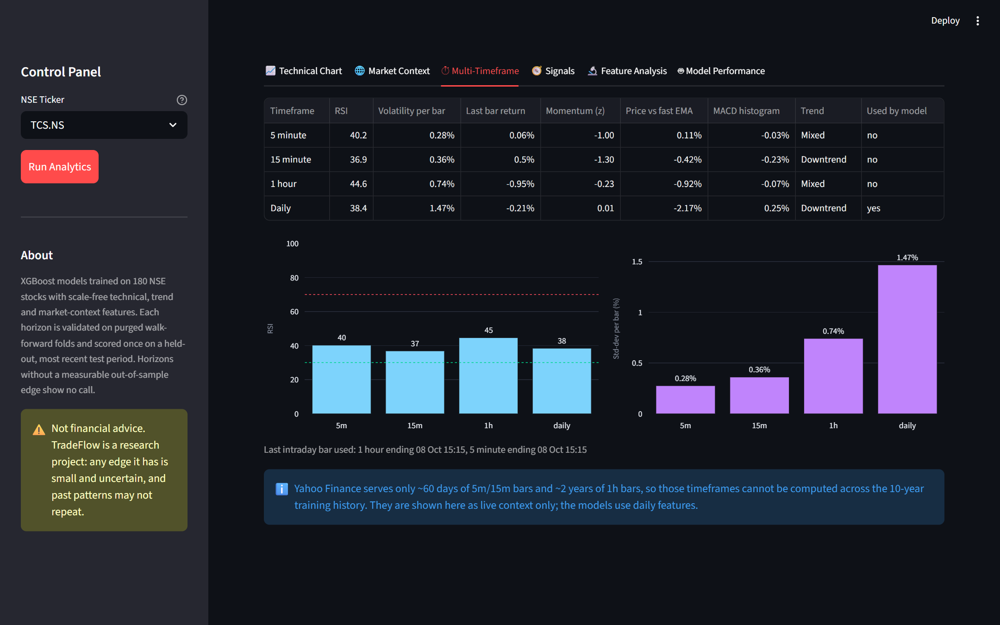 |
| **🧭 Signals** | **🔍 Why the model says this** |
| 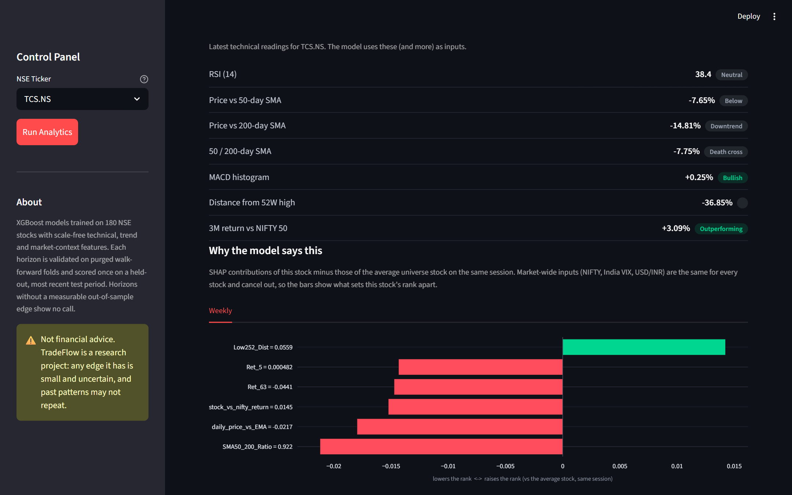 | 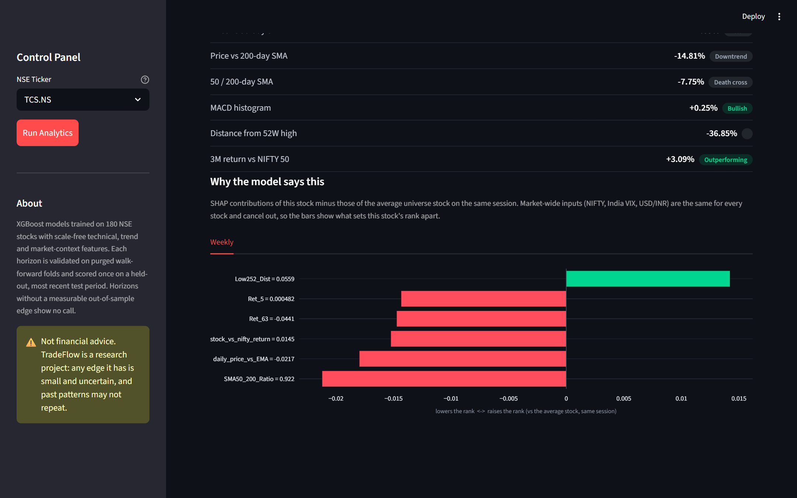 |
| **🔬 Feature analysis** | **🧮 Feature correlation** |
| 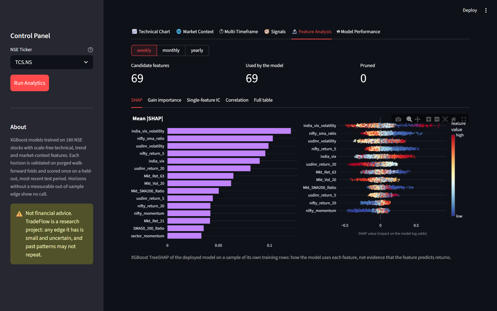 | 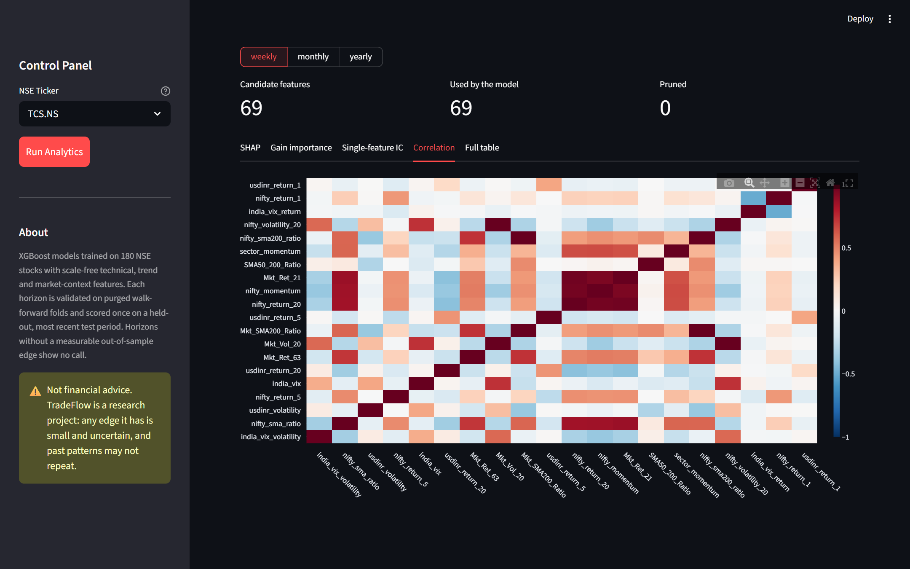 |
| **🤖 Model performance** | **🧪 Experiment log** |
| 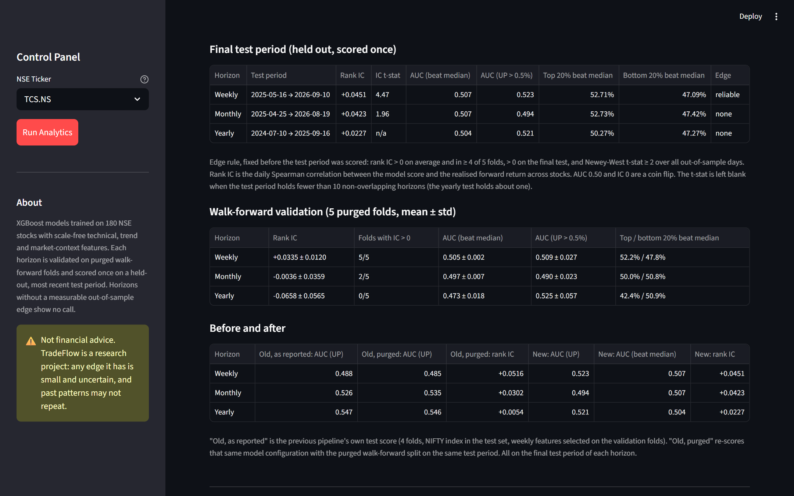 | 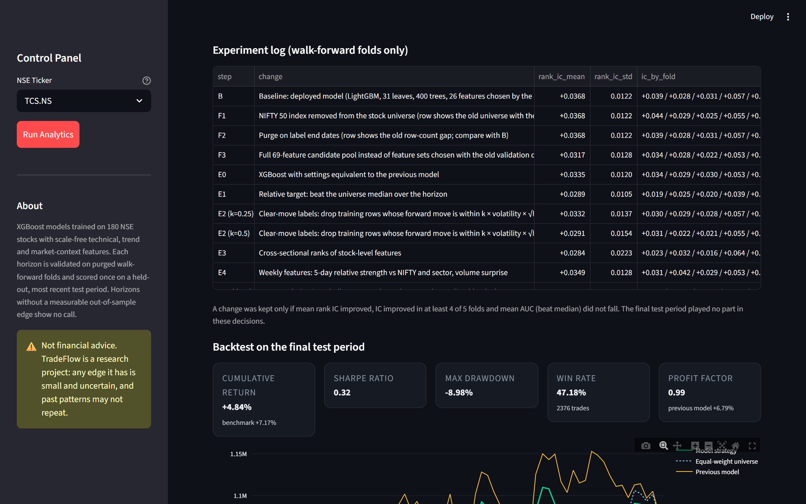 |
| **💹 Backtest** | |
| 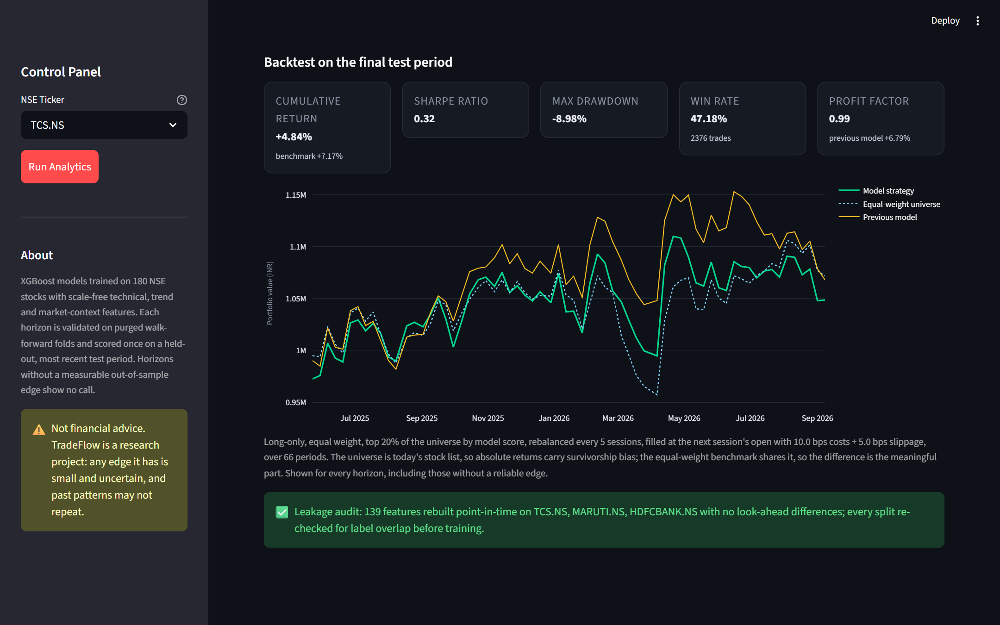 | |

## Tech stack

Python · Streamlit · pandas / NumPy · XGBoost (CUDA or CPU) · scikit-learn · Plotly · yfinance · joblib ·
pytest (LightGBM only to re-score the previous models)

---

Built by [@piyushp69](https://github.com/piyushp69). Market data from Yahoo Finance; availability and accuracy are not guaranteed.
